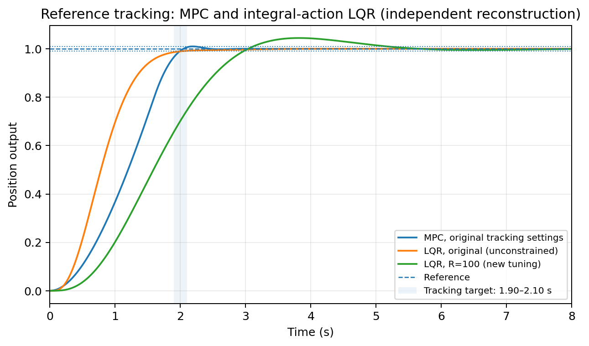
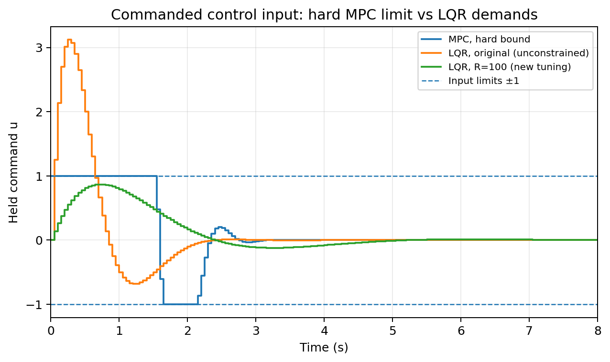
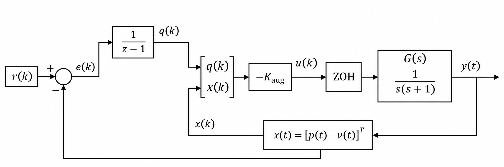

# Discrete-Time LQR and Constrained MPC for Mass–Damper Control

**Reference tracking under actuator-force limits · MATLAB · Simulink**

This project compares two optimal-control approaches for a normalized mass–damper system: **linear–quadratic regulation (LQR) with integral action** and **constrained model predictive control (MPC)**. Both controllers track the same position reference, but handle control effort differently.

> **Engineering question:** Can constrained MPC achieve fast position tracking while respecting a force limit that the original integral-action LQR exceeds?

The project focuses on controller design, sampled-data modelling, quadratic optimization, and measurable closed-loop trade-offs. It is based on *Digital Control Technologies and Architectures* coursework at **Politecnico di Torino**.

## 1. System model

The plant is a mass subject to an applied force and viscous damping, with no spring. In normalized units, its dynamics are

$$
\ddot{p}(t) + \dot{p}(t) = u(t),
$$

where $p$ is position and $u$ is applied force. With $x(t) = [p(t)\;v(t)]^{\mathsf T}$ and $v=\dot p$, the continuous-time state-space model is

$$
\dot{x}(t)=Ax(t)+Bu(t), \qquad y(t)=Cx(t),
$$

$$
A = \begin{bmatrix}
0 & 1 \\
0 & -1
\end{bmatrix},\qquad
B = \begin{bmatrix}
0 \\
1
\end{bmatrix},\qquad
C = \begin{bmatrix}1 & 0\end{bmatrix}.
$$

The controllers operate at a sampling period of $T_s=0.05\,\mathrm{s}$ (20 Hz). Exact zero-order-hold discretization gives

$$
x_{k+1}=A_d x_k+B_d u_k,\qquad y_k=Cx_k,
$$

$$
A_d = \begin{bmatrix}
1 & 0.04877058 \\
0 & 0.95122942
\end{bmatrix},\qquad
B_d = \begin{bmatrix}
0.00122942 \\
0.04877058
\end{bmatrix}.
$$

The same discretized plant, initial state $x_0=[0\;0]^{\mathsf T}$, and unit-step position reference $r=1$ are used in every controller comparison.

## 2. Controller design

### Integral-action LQR

To remove steady-state error for a constant reference, a discrete integral state accumulates position error:

$$
q_{k+1}=q_k+T_s(r_k-y_k).
$$

For the augmented state $z_k=[q_k\;p_k\;v_k]^{\mathsf T}$, the reference-tracking model is

$$
z_{k+1}=A_{\mathrm{aug}}z_k+B_{\mathrm{aug}}u_k+E_r r_k,
\qquad y_k=C_{\mathrm{aug}}z_k,
$$

$$
A_{\mathrm{aug}}=\begin{bmatrix}
1 & -0.05 & 0 \\
0 & 1 & 0.04877058 \\
0 & 0 & 0.95122942
\end{bmatrix}, \qquad
B_{\mathrm{aug}}=\begin{bmatrix}
0 \\
0.00122942 \\
0.04877058
\end{bmatrix},
$$

$$
E_r=\begin{bmatrix}
0.05 \\
0 \\
0
\end{bmatrix},\qquad
C_{\mathrm{aug}}=\begin{bmatrix}0&1&0\end{bmatrix}.
$$

The control law is $u_k=-K_{\mathrm{aug}}z_k$, with $K_{\mathrm{aug}}$ computed by MATLAB's `dlqr` from

$$
Q_{\mathrm{aug}}=\operatorname{diag}(850,150,1),\qquad R=1.
$$

A second, **illustrative** LQR configuration uses $R=100$ to study the effect of penalizing the applied force more heavily. LQR in this project is **unconstrained**: a lower calculated peak force is not equivalent to a hard actuator guarantee.

### Constrained MPC

MPC predicts future positions over **25 samples** and chooses **25 future input increments**, $\Delta u_k=u_k-u_{k-1}$. At each sampling instant it solves the quadratic program

$$
\min_{\Delta U}\;\sum_{i=1}^{25}120000\,(y_{k+i\mid k}-r)^2
+\sum_{i=0}^{24}120\,(\Delta u_{k+i\mid k})^2
$$

subject to the predicted discrete-time dynamics and

$$
-1\leq u_{k+i\mid k}\leq1,
\qquad y_{k+i\mid k}\leq1.0099.
$$

The optimization is implemented directly with MATLAB's `quadprog`. Only the first control increment is applied; the optimization is repeated at the next sampling instant (receding-horizon control).

**Important:** Changes in force are penalized in the MPC objective, but there is **no hard input-rate constraint** in this focused tracking project.

## 3. Numerical comparison

The controllers were evaluated with the same initial conditions and position reference. Settling time is measured using a **1% reference-tracking band**; control energy is computed as $T_s\sum_k u_k^2$.

| Controller | 1% settling time | Peak $\lvert u\rvert$ | Control energy |
|:--|--:|--:|--:|
| Integral LQR · original weights | 2.014 s | 3.121 | 3.885 |
| Integral LQR · increased $R=100$ | 5.165 s | 0.866 | 0.796 |
| **Constrained MPC** | **1.991 s** | **1.000** | 2.145 |

**Position tracking**



**Applied force and actuator limit**



The original integral-action LQR tracks quickly but requests more than three times the allowed force magnitude. Increasing its input weight reduces the peak demand at the expense of a slower response. For the stated nominal model and controller settings, MPC reaches the tracking band in approximately two seconds while enforcing the $\pm1$ sampled input bound.

This is a comparison of **specific controller configurations**, not proof that MPC is universally superior or that no other LQR tuning could satisfy both objectives.

*Evidence status:* These numbers and the two plots were obtained from an **independently executed Python/SciPy–CasADi reconstruction**. The packaged MATLAB and Simulink programs have **not yet been executed in MATLAB**. Details are recorded in [VALIDATION.md](VALIDATION.md).

## 4. Simulink implementation

An editable Simulink model accompanies the MATLAB comparison. It implements the **integral-action LQR** using a discrete tracking-error integrator and sampled state feedback connected to the continuous-time plant through a zero-order hold.



*Actual block-diagram thumbnail embedded in the supplied `.slx` file, cropped for readability. This is not a screenshot of an executed simulation.*

The model contains a step reference, error feedback, discrete integrator, LQR gains, a zero-order hold, the continuous-time plant, and output logging. It corresponds to the augmented state-space equations in Section 2.

To open and run the included model from the repository root:

```matlab
run_simulink_lqr
open_system('integral_lqr_tracking')
```

[View the editable Simulink model](simulink/integral_lqr_tracking.slx) · [View its setup script](run_simulink_lqr.m)

**Scope:** Simulink is included for the **LQR architecture**. The constrained MPC controller is implemented in MATLAB using `quadprog`, not in Simulink. The Simulink model was inspected but has not been runtime-validated in this environment.

## 5. Reproducing the project

**Requirements:** MATLAB with **Control System Toolbox** and **Optimization Toolbox**. **Simulink** is additionally required for the optional block-diagram model.

Clone or download the repository, open its root directory in MATLAB, and run:

```matlab
run_project
```

This script discretizes the plant, designs both LQR variants, solves the MPC optimization at every sample, computes performance metrics, and saves a comparison table and two figures. New MATLAB outputs are written separately from the independently generated reference figures.

The codebase is intentionally small:

| File | Purpose |
|:--|:--|
| [`run_project.m`](run_project.m) | Plant modelling, controller design, simulation, metrics, and plots |
| [`solve_mpc.m`](solve_mpc.m) | Readable constrained MPC quadratic program |
| [`run_simulink_lqr.m`](run_simulink_lqr.m) | Setup and optional Simulink simulation |
| [`simulink/integral_lqr_tracking.slx`](simulink/integral_lqr_tracking.slx) | Editable LQR block diagram |
| [`figures/`](figures/) | Position, force, and Simulink architecture visuals |
| [`results/`](results/) | Independently generated comparison results |
| [`VALIDATION.md`](VALIDATION.md) | Verification evidence and limitations |

## 6. Scope and limitations

- The plant is an **idealized, linear, normalized, fully observed** model; it is not a vehicle model or a hardware demonstration.
- MPC enforces the **input bound** in its discrete-time optimization. The **position upper bound** is checked at prediction instants; independent continuous-time evaluation found a small intersample exceedance of approximately $5.37\times10^{-5}$ above that ceiling.
- LQR and MPC minimize **different objectives**. Results reflect this design comparison, rather than an identical-cost optimality test.
- No robustness guarantee, state estimator, real-time execution benchmark, hardware validation, or formal MPC stability proof is claimed.
- MATLAB and Simulink runtime validation remains outstanding; see [verification notes](VALIDATION.md).

## Acknowledgment

The normalized plant, control objectives, and baseline tuning are adapted from *Digital Control Technologies and Architectures*, **Politecnico di Torino** (M. Canale). The MATLAB comparison and MPC optimizer are newly written reconstructions of the coursework methods. The included editable LQR Simulink model originates from the coursework. The extra $R=100$ LQR comparison and extended simulation interval are separately identified additions.
