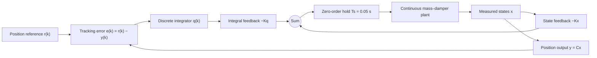

# Discrete-Time LQR vs Constrained MPC for Mass–Damper Control

**Reference tracking under actuator-force constraints | MATLAB & Simulink**

This project investigates a practical question in optimal control: **can a controller track a position reference quickly while respecting a limited actuator force?** A discrete-time linear–quadratic regulator (LQR) with integral action is compared with constrained model predictive control (MPC) on the same mass–damper system. The emphasis is on reproducible simulation, constraint handling, and quantitative performance—not on demonstrating that one method is universally better.

Developed from *Digital Control Technologies and Architectures* coursework at **Politecnico di Torino**, with a focused MATLAB reconstruction and an accompanying Simulink model of the integral-LQR architecture.

## System model

The normalized continuous-time model is

$$
\dot{x}(t)=\begin{bmatrix}0&1\\0&-1\end{bmatrix}x(t)
+\begin{bmatrix}0\\1\end{bmatrix}u(t),
\qquad y(t)=\begin{bmatrix}1&0\end{bmatrix}x(t).
$$

Here, $x=[p\;v]^T$ contains position and velocity, $u$ is the applied force, and $y=p$ is the controlled output. The plant is discretized with a **zero-order hold** and sampling time $T_s=0.05\,\mathrm{s}$:

$$x_{k+1}=A_dx_k+B_du_k.$$

All comparisons use a unit-step position reference, zero initial position and velocity, and identical plant dynamics.

## Control strategies

### Integral-action LQR

A discrete integrator accumulates the position-tracking error:

$$q_{k+1}=q_k+T_s(r_k-y_k),\qquad
u_k=-K\begin{bmatrix}q_k\\x_k\end{bmatrix}.$$

The baseline uses $Q=\mathrm{diag}(850,150,1)$ and $R=1$. A second LQR design increases the input weight to **$R=100$** to illustrate the effect of discouraging large control forces. Neither LQR design imposes a hard force constraint.

### Constrained MPC

MPC predicts **25 samples ahead** and optimizes a sequence of input changes, $\Delta u_k=u_k-u_{k-1}$. The quadratic objective is

$$
J=\sum_{i=1}^{25}120000\big(y_{k+i\mid k}-r\big)^2
+\sum_{i=0}^{24}120\big(\Delta u_{k+i\mid k}\big)^2,
$$

subject to predicted sampled-time constraints

$$-1\leq u_{k+i\mid k}\leq1,\qquad y_{k+i\mid k}\leq1.0099.$$

A quadratic program is solved with MATLAB's `quadprog` at each sampling instant; only the first move is applied before the problem is solved again. **Input changes are penalized, not hard-limited** in this tracking configuration.

## Results

The two plots below compare **position tracking** and **applied force** under identical nominal conditions.

### Position tracking


### Control input


| Controller | 1% settling time | Peak absolute force | Input energy $T_s\sum_k u_k^2$ |
|:--|--:|--:|--:|
| Integral LQR, baseline | 2.014 s | 3.121 | 3.885 |
| Integral LQR, $R=100$ | 5.165 s | 0.866 | 0.796 |
| Constrained MPC | **1.991 s** | **1.000** | 2.145 |

**Main observation.** The baseline LQR tracks quickly but demands a force greater than the $\pm1$ actuator limit. The more conservative LQR remains below that limit in this nominal case but settles much more slowly. The configured MPC achieves approximately two-second tracking while directly enforcing the force bound. These results compare particular designs, **not the best possible tuning of either controller**.

*Result provenance:* The plotted trajectories and tabulated values come from an independently executed Python/SciPy–CasADi reconstruction of the stated model and controllers. They have **not yet been reproduced by running the packaged MATLAB code**. See [verification notes](VALIDATION.md).

## Simulink control architecture

The repository includes an **editable Simulink implementation of the integral-action LQR**. It uses sampled reference-error integration and state feedback to control a continuous-time mass–damper plant through a zero-order hold.



*Simplified signal-flow diagram of the included Simulink model; not an execution screenshot.*

The model contains the reference step, summing junctions, discrete-time integrator, feedback gains, zero-order hold, continuous-time plant, and signal logging. Open the native block diagram in Simulink to inspect its implementation:

```matlab
run_simulink_lqr
open_system('integral_lqr_tracking')
```

[View the editable Simulink model](simulink/integral_lqr_tracking.slx) · [View the setup script](run_simulink_lqr.m)

**Scope:** Simulink illustrates the **LQR** controller only. Constrained MPC is implemented in MATLAB with `quadprog`, not as a Simulink block. The Simulink file was inspected structurally but has **not yet been run or validated in MATLAB/Simulink** in this environment.

## Reproduce the comparison

**Requirements:** MATLAB, Control System Toolbox, and Optimization Toolbox. Simulink is optional for viewing and running the LQR block diagram.

1. Clone or download the repository and open its root folder in MATLAB.
2. Run the complete comparison:

   ```matlab
   run_project
   ```

3. Optionally inspect the LQR model using the Simulink commands above.

The main script prints a performance table and generates **two figures** and one CSV table. To preserve traceability, newly generated MATLAB outputs use different filenames from the independent verification plots already included in the repository.

### Repository contents

| File or directory | Purpose |
|:--|:--|
| [`run_project.m`](run_project.m) | Plant discretization, LQR design, MPC comparison, metrics, and figures |
| [`solve_mpc.m`](solve_mpc.m) | Receding-horizon quadratic-program solution |
| [`run_simulink_lqr.m`](run_simulink_lqr.m) | Simulink initialization and optional simulation |
| [`simulink/`](simulink/) | Editable integral-action LQR model |
| [`figures/`](figures/) | Two independently generated comparison plots |
| [`results/`](results/) | Independently generated metrics table |
| [`VALIDATION.md`](VALIDATION.md) | Numerical checks, provenance, and known limitations |

## Interpretation and limitations

- The model is **linear, normalized, deterministic, and fully observed**. It is a control-method demonstration, not a vehicle-dynamics model.
- The nominal force bound applies to the MPC's held input; the **output bound is enforced at prediction instants**. Independent simulation found a small continuous-time intersample exceedance (approximately $5.37\times10^{-5}$ above the specified output ceiling).
- The two LQR settings and MPC have **different cost functions**; the results should be interpreted as an illustrative controller-design trade-off rather than a globally optimized comparison.
- No robustness, state-estimation, hardware, real-time feasibility, or formal MPC stability guarantees are claimed.
- The MATLAB and Simulink files still require **runtime validation in MATLAB**. Independent numerical checks and their limitations are documented in [VALIDATION.md](VALIDATION.md).

## Acknowledgment

The system model, control objectives, and baseline controller settings originate from *Digital Control Technologies and Architectures*, **Politecnico di Torino** (course instruction by M. Canale). The main MATLAB scripts are reconstructed implementations; the included integral-LQR Simulink model originates from the coursework. The $R=100$ LQR comparison and longer simulation interval are additional analysis choices. This repository does not redistribute the teaching handouts or legacy MPC library.
